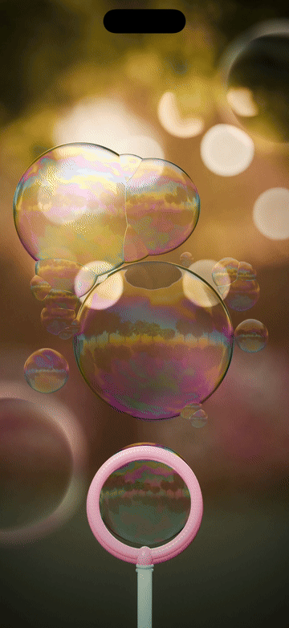
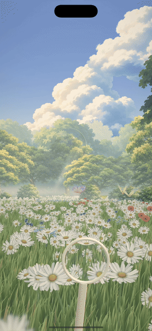

# Soap Bubbles: blow into the phone

iPhone demo: blow into the microphone and soap bubbles swell out of a plastic wand. A soft, long breath grows one giant
wobbly bubble, a sharp puff sprays a stream of little ones. Rainbow colours swirl and drain over every film (real thin-film
interference, computed per pixel over 10 wavelengths in a Skia runtime shader), bubbles bump, stick together into clusters
with flat shared walls, and burst into glinting droplets when tapped. Blender renders the backlit golden-hour garden and the
environment map the bubbles reflect; Reanimated runs the physics on the UI thread; expo-audio streams mic PCM for the breath.
Design notes: [PLAN.md](PLAN.md).

<p align="center">
  <a href="docs/demo.mp4"></a>
  <br>
  <a href="docs/demo.mp4"><b>▶ Watch the 2D demo with sound (MP4, 17 s)</b></a>
</p>

A second mode flies through a painted 3D daisy meadow: blow a big bubble, then the camera drifts after it over the
flowers until it pops (three.js WebGPU on React Native, lofi music over real birdsong).

<p align="center">
  <a href="docs/garden3d.mp4"></a>
  <br>
  <a href="docs/garden3d.mp4"><b>▶ Watch the 3D garden with sound (MP4, 48 s)</b></a>
</p>

Built with **Expo · React Native · [react-native-skia](https://shopify.github.io/react-native-skia/) ·
Reanimated 4 · [three.js](https://threejs.org/) (WebGPU, TSL) on
[react-native-webgpu](https://github.com/wcandillon/react-native-webgpu) · React Three Fiber · Blender**.

## App structure

```
app/src/scene/BubbleScene.tsx   Canvas, layers, clock, gestures, demo playback, haptics, look crossfade
app/src/scene/looks.ts          the two lighting looks (golden hour, twilight): pictures, env gain, highlight
app/src/sim/pool.ts             bubble pool (flat arrays), spawn, bonds, pop, hit tests, seeded random
app/src/sim/step.ts             physics step: wand film / growth / pinch-off / spray, forces, wobble springs,
                                contacts (bounce or stick at the Plateau distance), pops shedding droplets, ageing
app/src/audio/breath.ts         mic stream (float32 PCM) → breath envelope 0…1 (level × low-frequency share)
app/src/shaders/film.ts         thin-film interference, film thickness field (drainage + Marangoni eddies + ageing)
app/src/shaders/bubbles.ts      all bubbles in one pass: sphere + wobble, front/back reflections, clusters, pop holes
app/src/shaders/wandFilm.ts     the film in the wand ring (bulge, re-forming, flutter)
app/src/shaders/post.ts         vignette, warm lift, grain
app/src/demo/script.ts          storyboard: opening cluster, breath curve, herding, taps, self-pop of the giant
app/src/fx/sfx.ts               in-app sound effects (pops, pinch-off bloop, puffs, sticks) · fx/haptics.ts
app/src/ui/MicHint.tsx          first-run "blow gently" hint
```

## Run

```bash
cd app
npm install
npx expo run:ios --device "Soap Bubbles 17 Pro Max" --port 8092
```

On the simulator the Mac microphone is used; you can also press and hold the wand to fake a breath (drag up = harder).
Tap a bubble to pop it, press and drag a bubble to carry it with a "wet finger", drag empty space to waft air,
tap the sun to let it set (golden hour → twilight with fairy lights; tap the big lantern to bring the sun back; a
two-finger tap also switches; `EXPO_PUBLIC_LOOK=night` starts there;
in demo mode `EXPO_PUBLIC_LOOKSWITCH=7.4` crossfades day → night at that scene time).

Demo playback for recordings: build Release with `EXPO_PUBLIC_DEMO=1 EXPO_PUBLIC_TIMESCALE=0.5`, then `tools/rec.sh`.
Shader check without a device: `node tools/perf/sksl_check.mjs`.

## 3D garden mode

A second mode (button "3D" in the 2D app, or `EXPO_PUBLIC_MODE=3d`): a painted anime daisy meadow with real depth, in
three.js (`WebGPURenderer` + TSL node materials) on react-native-webgpu (Dawn → Metal; OpenGL ES in the iOS simulator is
CPU-rendered, so expo-gl was dropped). Blow and the bubble grows on the wand; a big one flies off over the flowers, after
about a second the camera zooms in and follows it until it pops, then comes home. Tap a bubble to pop it, press and hold
for a breath without the mic.

```
app/src/garden3d/Garden3D.tsx    canvas, wand, bubbles (instanced, thin-film WGSL + cube-map reflections), camera rig, veil
app/src/garden3d/FiberCanvas.tsx React Three Fiber on a WebGPU canvas (native resolution, present after each frame), textures
app/src/garden3d/World.tsx       sky, clouds, painted tree / bush / meadow cards, ground, mist, sunbeams, butterflies, bokeh
app/src/garden3d/Grass.tsx       380k instanced grass blades (folded, twisted) with travelling wind waves
app/src/garden3d/Flowers3D.tsx   Blender daisies, buttercups, forget-me-nots, poppies, cornflowers, clover, cow parsley (GLB, instanced), butterfly landing spots
app/src/garden3d/Droplets.tsx    the droplet spray of a pop · Petals.tsx: drifting petals
app/src/garden3d/sim3d.ts        bubble physics in metres (blowing, release, spray, breeze, ageing, contacts)
app/src/garden3d/Post.tsx        grade: saturation, split tone, soft blacks, vignette, grain (4× MSAA scene pass)
app/src/garden3d/demo3d.ts       scripted breath for recordings (EXPO_PUBLIC_DEMO3D=1)
assets/garden3d/tex/             painted textures (Codex), see its README · assets/garden3d/models/: Blender GLBs
blender/scripts/garden3d_props.py   the GLB props (vertex colours, baked AO; daisy heads uv-mapped to the painted atlas)
tools/paint_daisy.py                the painted daisy head atlas (numpy; run with Blender's Python)
blender/scripts/lofi_garden.py      the 3D garden's lofi music (used by mix_clip.py, style "lofi")
blender/audio/birds/                real birdsong (public domain field recordings, see its README)
```

Record: `tools/rec3d.sh gN` (quits the dev app on the other simulator first: a paused WebGPU app there stalls this one),
then `python3 tools/events3d.py render/promo/gN/app.log blender/scripts/beats/gN.json` (sound events from the app's own
log) and `tools/promo.sh --beats blender/scripts/beats/gN.json --screen render/promo/gN/screen.mp4 --film-start $(cat
render/promo/gN/film_start.txt)`. Versions: `notes/versions.md` (g rows).

All the 3D showcase videos in one go (beat sheet from the `g34b` layout: the long calm cut with lofi music and real birdsong, audio, plate, promo, contact sheet, versions
reel, then `tools/pack3d.sh` into `render/showcase-pack/`):

```bash
tools/rec3d.sh g36
VERSIONS="g2:first_take g8:painted_meadow g16:3D_flowers g32:short_cut g36:long_lofi_cut" tools/final3d.sh g36
```

Another soundtrack on the same picture (no re-render): copy `blender/scripts/beats/g36.json` to e.g. `g36p.json`, set
`"music": {"style": "piano", "bars_to_card": 12}` and `"audio": "render/audio/mix_g36p.wav"`, then `tools/remux3d.sh g36 g36p`
(styles: `lofi` → `blender/scripts/lofi_garden.py`, `piano` → `blender/scripts/calm_piano.py`, both with the real birdsong of
`blender/audio/birds/`).

On a slower GPU the garden lowers its pixel ratio by itself (3 → 2.25 → 1.5 under 48 fps; `EXPO_PUBLIC_FPS_FLOOR`).

## Looks

Four Blender-rendered backgrounds, all loaded at start (`app/src/scene/looks.ts`): **golden** hour (v2,
`golden2_look.py`: backlit park at sunset, assets in `assets/scene/golden2/`), **night** (twilight with fairy lights, the
main look and the start look), **studio** (black velvet, a softbox and a broad diffuser behind the photographer: swirling
colour over every bubble face, bubble-macro style) and **dawn** (misty pastel spring morning with blossoms). A two-finger
tap or a tap on the key light crossfades to the next one; `EXPO_PUBLIC_LOOK=<name>` starts there. Each look also sets the
film parameters (`lookK`: bulb lift, film colour, black-film veil, back-surface gain; `filmF`: swirl scale). A new look = `blender/scripts/<name>_look.py` with `apply(globals())`, `LOOK=<name> tools/build.sh`, then
`LOOK=<name> tools/env_atlas.sh`, then an entry in `looks.ts`.

## Videos (like the showcase projects)

The recordings and renders live in `render/` (tens of GB), which is not in the repository; the scripts below rebuild them.

- `render/promo/soap-bubbles-demo-vN.mp4`: the 4:3 promo (Blender phone mockup, words, end card, mix).
- `tools/screen_video.sh`: the raw recording as a 720×1564 portrait video with the soundtrack.
- `tools/versions_reel.sh`: several versions (or looks) side by side, labelled (`tools/text_png.mjs` draws the labels with
  CanvasKit: this ffmpeg has no drawtext).
- `tools/pack.sh`: everything as a showcase pack in `render/showcase-pack/` (video/, images/, README, CAPTION).

## Audio session (device)

`patches/expo-audio+58.0.11.patch` (applied by `postinstall: patch-package`) makes the mic stream use `.playAndRecord` +
`mixWithOthers` instead of `.record/.measurement`, which muted every sound effect while the mic was on. The SFX players keep
the session active (otherwise expo-audio deactivates it after each sound and the mic stops), background audio is off in
`app.json`, and the mic is stopped in the background and restarted on return (which also recovers from a phone call).
These paths only run on a real iPhone (the simulator mic is silent); check them there with `EXPO_PUBLIC_MICLOG=1`.

## Background (Blender)

```bash
PREVIEW=1 tools/build.sh      # quick look (50 %, 48 samples, ~20 s)
tools/build.sh                # final: 100 %, 256 samples (~3.5 min on an M5 Pro)
```

After a Blender env re-render run `LOOK=golden tools/env_atlas.sh` (and `LOOK=night tools/env_atlas.sh` after
`LOOK=night tools/build.sh`): each app env map is a three-level atlas (sharp / mid / soft), the shader picks the level
per pixel so big bubbles mirror crisp light strings without aliasing (the older single-level `golden_env.sh` /
`night_env.sh` are kept for reference).

Details in [blender/README.md](blender/README.md): garden at golden hour (Codex-made leaf / flower / grass cards), the
wand, the equirectangular environment the bubbles reflect, `layout.json`.

## Recording the demo clip (for X)

Two simulators: "Soap Bubbles 17 Pro Max" for development (Debug, Metro on port 8092) and
"Soap Bubbles Rec 17 Pro Max" for recordings (Release). Grant the microphone before the first launch of a new sim
(`xcrun simctl privacy <udid> grant microphone dev.hoanghoa.soapbubbles`), otherwise iOS shows a system alert that
can't be dismissed on a headless sim (reboot the sim to clear it).

```bash
R=21EF24EC-6B38-4761-84D7-E5F7CBF5DFBF                     # the Rec sim
UDID=$R DEMO=1 TS=0.5 tools/embed.sh                       # current JS into the Release app (no native build)
                                                           # LOOK=night / LOOKSWITCH=7.4 for the other clips
UDID=$R TS=0.5 SECS=20 OUT=render/promo/vN tools/rec.sh    # record at half speed → 60 fps CFR screen.mp4
tools/filmstart.sh render/promo/vN/screen.mp4              # second of the app's first frame
cp blender/scripts/beats/v5.json blender/scripts/beats/vN.json   # set "audio": "render/audio/mix_vN.wav"
tools/promo.sh --beats blender/scripts/beats/vN.json --screen render/promo/vN/screen.mp4 \
  --film-start <S> --out render/promo/soap-bubbles-demo-vN.mp4
tools/sheet.sh render/promo/soap-bubbles-demo-vN.mp4 render/promo/soap-bubbles-sheet-vN.jpg blender/scripts/beats/vN.json
```

One-shot version (dev Metro running with the same `EXPO_PUBLIC_LOOK` + `EXPO_PUBLIC_EVLOG=1`): `V=vN LOOK=night
render/promo/queue_rec.sh` logs the events on the dev sim, embeds and records on the Rec sim and prints the film start; then
`python3 tools/events.py render/promo/vN/metro.log blender/scripts/beats/vN.json`, mix, promo, sheet.
`PCT=50 … --stills 0,4,9.8` renders a few half-size stills first. Beat sheet `words` put BLOW / STICK / POP beside the
phone (`[word, t0, t1, colour, alpha, size, x, stack]`, see `promo.py`). Pipeline details, audio and caption:
[notes/promo.md](notes/promo.md). Dev helpers: `tools/burst.sh` (screenshot burst of the dev sim),
`EXPO_PUBLIC_T0=<s>` (fast-forward the demo), `EXPO_PUBLIC_TIMESCALE=<k>` (slow clock), `EXPO_PUBLIC_EVLOG=1` +
`tools/events.py` (event times → beat sheet), `tools/showcase.sh vN "note"` (saved snapshot per version in
`render/showcase/`), version log in [notes/versions.md](notes/versions.md).

## License

[MIT](LICENSE) © Hoa Hoang ([@novahoangdev](https://x.com/novahoangdev)). The birdsong in `blender/audio/birds/` is public
domain (sources in its README).
